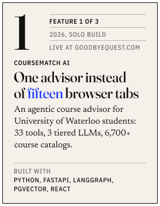
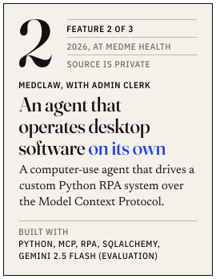
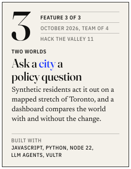
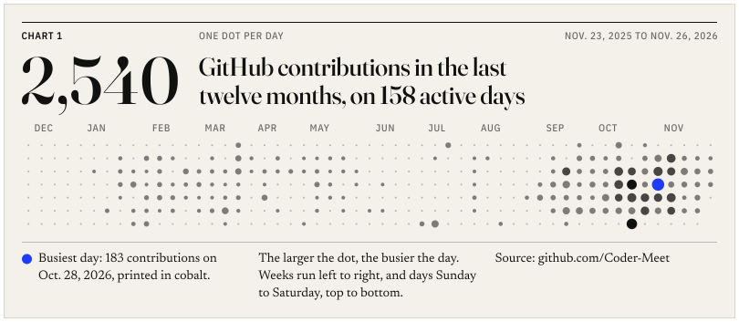

  <a href="https://letsmeetpatel.com">
    <picture>
      <source media="(prefers-color-scheme: dark)" srcset="assets/banner-dark.svg">
      
    </picture>
  </a>

I build agents and the backend systems around them. I'm a third-year Computer Science student at the University of Waterloo, currently on my fourth internship. What I like most is being handed a hard system and owning it from nothing to shipped.

### Latest

- Software engineer intern at Modern Menopause in Toronto, working across a NestJS and GraphQL API, a React pharmacy portal and a patient app.
- Computer Science at the University of Waterloo, AI specialization, 3.9 GPA.
- Open to Summer 2027 internships.

### Features

<!-- The banner and the chart are 810 px wide and each card is 270, so the three cards have to sit edge to edge to line up with them. Each image carries its own margin. The comments between the tags are only there to keep spaces out. -->

  <a href="https://goodbyequest.com"><picture><source media="(prefers-color-scheme: dark)" srcset="assets/card-coursematch-dark.svg"></picture></a><!--
  --><picture><source media="(prefers-color-scheme: dark)" srcset="assets/card-medclaw-dark.svg"></picture><!--
  --><a href="https://github.com/Coder-Meet/agentic-social-research"><picture><source media="(prefers-color-scheme: dark)" srcset="assets/card-twoworlds-dark.svg"></picture></a>

CourseMatch AI is live at [goodbyequest.com](https://goodbyequest.com). Two Worlds has a [repo](https://github.com/Coder-Meet/agentic-social-research) and a [live demo](https://twotwosmyworld.select/experience/). MedClaw and Admin Clerk were built at MedMe Health and are not public. The longer write-ups are on [my site](https://letsmeetpatel.com).

### Index of tools

- **Languages:** `Python` `TypeScript` `JavaScript` `SQL` `C/C++` `Bash` `Swift` `Kotlin` `HTML` `CSS`
- **AI and data:** `Agentic RAG` `LangGraph` `Gemini API` `OpenAI API` `pgvector` `Pandas` `PySpark` `ETL/ELT`
- **Backend and frameworks:** `FastAPI` `NestJS` `React` `Next.js` `Electron` `Express` `SQLAlchemy`
- **Cloud and infrastructure:** `AWS (Amplify, EC2, Lambda, S3)` `GCP (Vertex AI, Cloud Vision, Cloud SQL)` `Docker` `GitHub Actions`
- **Data acquisition:** `Playwright` `Selenium` `curl_cffi` `proxy rotation` `TLS fingerprinting (JA3)` `browser MCP`

### By the numbers

  <picture>
    <source media="(prefers-color-scheme: dark)" srcset="assets/contributions-dark.svg">
    
  </picture>

### Classifieds

**Wanted:** a hard system and a four-month window, May to August 2027.

[Website](https://letsmeetpatel.com) · [LinkedIn](https://linkedin.com/in/mp518) · [m46patel@uwaterloo.ca](mailto:m46patel@uwaterloo.ca)
